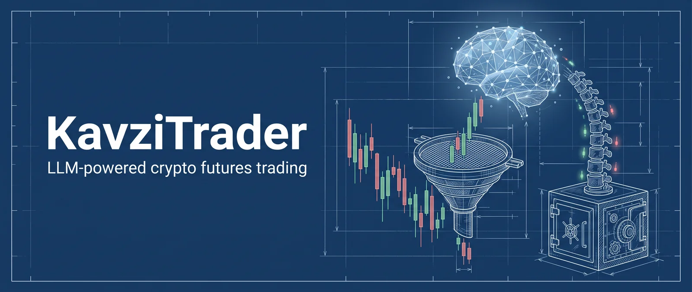
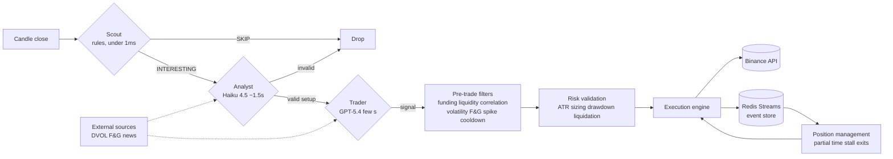

<p align="center"></p>

# KavziTrader

LLM-based trading platform for Binance USDT-M perpetual futures.

## About

KavziTrader is a **personal research project** exploring the trading
capabilities of Large Language Models. It is not a product, not a service, and
not financial advice.

## Disclaimer

Trading cryptocurrencies carries significant risk, including possible total
loss of capital. This software is experimental and provided "as is" with no
warranty. Use at your own risk. See [DISCLAIMER.md](DISCLAIMER.md) for the
full statement.

## Overview

KavziTrader uses a **Brain-Spine** split. The Brain is a tiered pipeline that decides *whether* and *what* to trade. The Spine is deterministic async Python that decides *how* and *when* to execute safely.

- **The Brain**: a rule-based Scout, then an Analyst LLM, then a Trader LLM. Both LLMs run through OpenRouter via PydanticAI.
- **The Spine**: pre-trade filters (funding, liquidity, correlation, volatility, Fear & Greed, spike cooldown), ATR-based risk validation, an execution engine and position management.
- **Order flow and external data**: funding rate and open interest per symbol, plus market-wide sentiment (DVOL, put/call ratio, Fear & Greed, news).
- **Event sourcing**: decisions and orders go to Redis Streams as an audit trail.

## Features

- **Tiered pipeline**: Scout is a deterministic filter (no LLM, under 1 ms) that drops about 90% of candles before any token is spent.
- **Risk**: ATR-based sizing, a leverage liquidation-price calculator used by the risk validator, drawdown limits.
- **Position management**: partial exits, time exits and stall exits.
- **Paper trading**: local simulated orders against live market data.
- **External sources**: Deribit DVOL and put/call ratio, Fear & Greed index and CCData news.
- **Realtime dashboard**: React UI fed by Redis streams over WebSocket.
- **Structured logging**: JSON logs and decision audit records.

## How it works

Trading runs on 15m candles of USDT-M perpetual futures (default leverage 5x, symbols in `trading.symbols`).

Scout (`kavzi_trader/spine/filters/scout.py`) returns INTERESTING or SKIP. Analyst (about 1.5 s) validates the setup. Trader (a few seconds) produces the signal. The Brain works at 0.5-5 s per decision. The Spine reacts in under 100 ms.

Model IDs are configurable. The current defaults in `config/config.yaml` are `anthropic/claude-haiku-4.5` for Analyst and `openai/gpt-5.4` for Trader.

Every 5 minutes a cheap LLM synthesizer (`deepseek/deepseek-chat-v3-0324` via OpenRouter) condenses the external sources into a summary. It goes into the Analyst and Trader prompts. Scout doesn't use it.



The orchestrator (`kavzi_trader/orchestrator/loops/`) runs concurrent async loops: ingest, order flow, reasoning, execution, position management and a UI snapshot loop.

## Project structure

```text
kavzitrader/
├── kavzi_trader/
│   ├── api/            # Binance REST and WebSocket clients
│   ├── brain/          # Agents, prompts, output schemas
│   ├── cli/            # Click CLI
│   ├── commons/        # Logging, time and async helpers
│   ├── config/         # AppConfig (YAML + env)
│   ├── domain/         # Shared Pydantic schemas and enums
│   ├── events/         # Redis Streams event store
│   ├── external/       # Sentiment and options data sources, synthesizer
│   ├── indicators/     # EMA, RSI, MACD, ATR and others
│   ├── infra/          # Redis client and config
│   ├── orchestrator/   # Async loops
│   ├── order_flow/     # Funding rate and open interest
│   ├── paper/          # Local paper-trading exchange
│   ├── spine/          # Filters, risk, execution, positions, state
│   └── ui/             # Dashboard backend (WebSocket server, publisher)
├── config/             # config.yaml
├── docker/             # Redis via docker-compose
├── reports/            # Post-session run analyses
├── results/            # Logs and run output
├── tests/              # Test suite
└── ui/web/             # Dashboard frontend (Vite, React, TypeScript)
```

## Installation

### Prerequisites

- Python 3.14+
- Docker (for Redis)
- Node.js (only to build the dashboard)

### Setup

1. Clone the repository:

   ```bash
   git clone https://github.com/doctormozg/kavzi-trader.git
   cd kavzi-trader
   ```

2. Install dependencies using uv:

   ```bash
   uv sync
   ```

3. Set up environment variables:

   ```bash
   cp .env.example .env
   # Add your OpenRouter key, plus Binance keys for live trading
   ```

4. Start Redis 7.4, which holds state, the event store and the dashboard streams:

   ```bash
   cd docker && docker-compose up -d
   ```

## Configuration

Main configuration lives in `config/config.yaml`, loaded through `kavzi_trader.config.AppConfig`.

Top-level sections: `system`, `api`, `brain`, `scout`, `trading`, `futures`, `risk`, `position_management`, `filters`, `redis`, `execution`, `events`, `orchestrator`, `monitoring`, `ui`, `external_sources`, `paper`.

`paper.mode` is `PAPER`, `LIVE` or `DISABLED`. It also sets the initial balance, commission rate and `reset_on_start` (set it to `false` to keep paper positions across restarts).

Environment variables:

- `KT_BINANCE_API_KEY`
- `KT_BINANCE_API_SECRET`
- `KT_OPENROUTER_API_KEY`
- `KT_ANTHROPIC_API_KEY` (only when an agent sets `provider: anthropic` in `config.yaml`)

Paper validation (`config --validate --paper`) needs only the LLM keys for the providers in use.

## Usage

```bash
# List commands
uv run kavzitrader --help

# Paper trading: simulated orders, live market data
uv run kavzitrader trade start --paper --paper-balance 1000

# Live trading
uv run kavzitrader trade start

# Check the config (add --paper for paper mode)
uv run kavzitrader config --validate

# Status, open positions, recent events
uv run kavzitrader trade status
uv run kavzitrader trade positions
uv run kavzitrader trade history

# Check the OpenRouter connection
uv run kavzitrader model status
```

`trade start --dry-run` only prints a message and exits without starting the orchestrator.

### Dashboard

```bash
# Build the frontend once (writes ui/web/dist)
cd ui/web && npm install && npm run build && cd ../..

# Serve it on 127.0.0.1:8780, streaming trader events from Redis
uv run kavzitrader ui serve

# Or try it with synthetic events, no trading needed
uv run kavzitrader ui demo
```

`ui export-schema` regenerates the JSON Schema that the frontend builds its TypeScript types from.

## Development

```bash
uv run pre-commit run --all-files
uv run pytest

# Frontend, from ui/web
npm run typecheck
npm test
```

## License

GPL-3.0-only. Copyright (c) 2026 Stanislav Gonorovskii. See [LICENSE](LICENSE).
